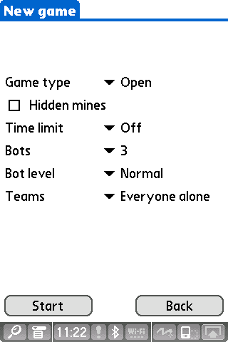
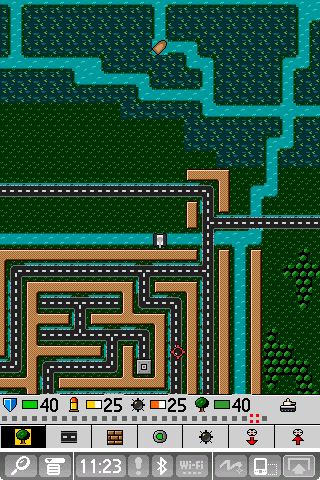
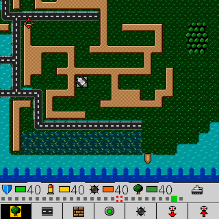
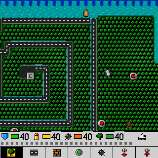

# PalmBolo

PalmBolo is Bolo for Palm OS. Drive a tank around an island, capture bases and pillboxes, and send your builder out to build roads, walls, boats and pillboxes of your own.

The game rules come from [WinBolo 2](https://github.com/john-winbolo/winbolo), rewritten to run on everything from a 16 MHz Palm III to a Tungsten TX, one build for all of them. Version 0.10.0 has two-player infrared games and up to 7 bots in single-player. The current source also adds up to eight-player UDP network games and four-player Bluetooth games; neither is in the 0.10.0 release.

Let me know what works and what doesn't, or open an issue here.

Enjoy, 
Dan

---

## Screenshots

<table>
  <tr>
    <td align="center"> Title, Tungsten TX</td>
    <td align="center"> New game, Tungsten TX</td>
    <td align="center"> Tungsten TX</td>
  </tr>
  <tr>
    <td align="center"> Palm IIIx</td>
    <td align="center"> Clié TG50</td>
    <td align="center"> Zire 72</td>
  </tr>
</table>

All from the [Frond](https://github.com/roge-rm/frond) emulator.

---

## Devices

Palm OS 3.0 and up, from 160×160 mono to 320×480 colour. So far it's been tested in Frond on a Tungsten TX, a Palm IIIx (it runs at full speed there), a Zire 72 and a Clié TG50 for the keyboard.

## Install

Download `PalmBolo-0.10.0.prc` from the releases page and install it with HotSync, or beam it from another Palm.

Real Bolo and WinBolo `.map` files work too. Everard Island is built in.

## Playing

New game picks a map, game type, hidden mines, time limit, bots, bot level and teams. Leaving a single-player game saves it and Resume carries on.

For two-player infrared, point the Palms at each other. On one Palm choose New game, pick the map and settings, then Host. On the other choose Join game, select Infrared and tap Join. Tap Start on the host once both players are in the lobby. The joiner receives the map if needed and keeps it for later. If the joiner leaves, a bot takes over. If the host leaves, the game ends. Multiplayer games cannot be resumed.

Infrared has been tested between Frond emulators, including a Palm IIIx and a Tungsten TX. It has not yet been tested between real Palms.

In the current source, Network uses the Palm's configured NetLib connection.
Choose Host, then Network in the link list and a UDP port (5046 by default).
Tap Address in the lobby to see the host's address and port. On the other Palms,
choose Join game, Network and Join, then enter that IPv4 address and port.
The host can start once the players have joined, up to eight people in all.
Network settings last until you quit the app.

Use a reachable address on the same network, or arrange routing and UDP port
forwarding yourself. There is no Internet lobby, host discovery or automatic
router setup. Network play is unencrypted and has no password. If Address is
unavailable, get the host's address from its network settings. The shared
protocol and UDP framing pass focused eight-peer host tests; NetLib play
between emulated or physical Palms still needs checking before release.

For Bluetooth in the current source, choose Host, then Bluetooth in the link
list. On the other Palms choose Join game, Bluetooth and Join, then select the
host in Palm's device picker. PalmBolo finds its game service and connects.
Up to four people can play, with bots filling the other seats if selected.
Cancel or Back closes the connection. Hosting needs Bluetooth free of another
open app connection. Devices without Bluetooth keep their other links.
Bluetooth passes focused callback and four-peer lockstep tests on the host;
Palm-to-Palm radio checks remain before-release work, with physical testing later.

Controls:
- Up and down: faster and slower
- Buttons 1 and 4, or the 5-way left and right: turn
- Button 2 or the 5-way centre: fire
- Button 3: lay a mine
- Tap the map to send the builder, and pick what he builds on the panel

The four buttons can be changed in Settings.

With a keyboard (Clié TG50, NX and UX, Treo or Centro, a Palm Universal or Wireless keyboard, a Stowaway, etc.):
- O and P, or left and right arrows: turn
- Q and A, or up and down arrows: faster and slower
- Space or Enter: fire
- Tab or Z: lay a mine
- K and L, or comma and full stop: gunsight nearer and further
- T, R, W, G and M, or 1 to 5: send the builder to the gunsight for trees, a road, a wall, a pillbox or a mine
- V: overview map
- Backspace or Escape: menu

On a Clié the jog dial moves the gunsight and pressing it fires.

## Building

Needs prc-tools-remix, PilRC, Python 3 and the Palm OS SDK 5r3 in `../palm-os-sdk`.

- `make` builds `build/PalmBolo.prc`
- `make DEBUG=1` adds the debug log, timers and self-test
- `make host-test` runs the game rules tests on Linux
- `make udp-test` runs focused UDP framing, eight-peer socket/lockstep and NetLib adapter checks
- `make bt-test` runs focused Bluetooth lifecycle and four-peer adapter/lockstep checks

## Licence

GPLv3, see LICENSE. The game rules come from WinBolo 2, also GPLv3.
