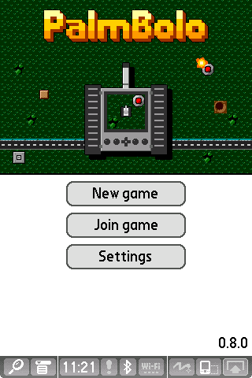
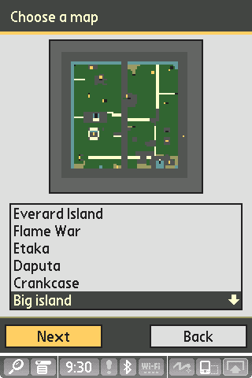
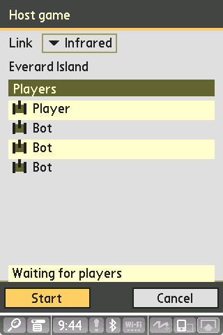
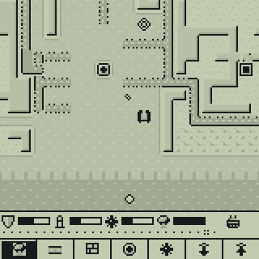
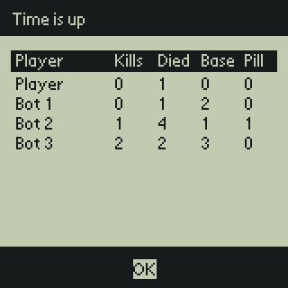
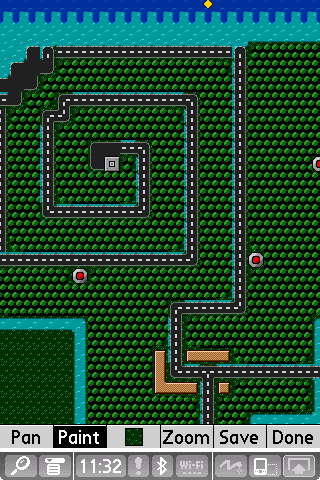
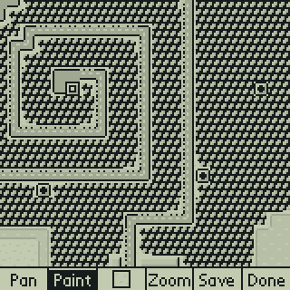

# PalmBolo

PalmBolo is Bolo for Palm OS. Drive a tank around an island, capture bases and pillboxes, and send your builder out to build roads, walls, boats and pillboxes of your own.

The game rules come from [WinBolo 2](https://github.com/john-winbolo/winbolo), rewritten to run on everything from a 16 MHz Palm III to a Tungsten TX, one build for all of them. Version 0.12.1 has up to 7 bots in single-player, two-player infrared, up to four players over Bluetooth and up to eight over a UDP network.

New in 0.12.1:
- New default buttons: 1 and 2 turn, 3 fires, 4 lays a mine

New in 0.12.0:
- A demo game plays on the title screen after a minute idle
- A map editor: edit a copy of any map or start a new island, paint with a brush, fill or box, place pillboxes, bases and starts, undo, and see the whole map at once
- Test play a map with bots from the editor, then save it to the map list and beam it

0.11.0, 0.12.0 and 0.12.1 can play together, and a game saved in 0.11.0 or 0.12.0 can be resumed in 0.12.1.

Let me know what works and what doesn't, or open an issue here.

Enjoy, 
Dan

---

## Screenshots

<table>
  <tr>
    <td align="center"> Title, Tungsten TX</td>
    <td align="center"> Choose a map</td>
    <td align="center"> Host lobby</td>
  </tr>
  <tr>
    <td align="center"> Tungsten TX</td>
    <td align="center"> Palm IIIx</td>
    <td align="center"> Results, Palm IIIx</td>
  </tr>
  <tr>
    <td align="center"> Map editor, Tungsten TX</td>
    <td align="center"> Map editor, Palm IIIx</td>
  </tr>
</table>

All from the [Frond](https://github.com/roge-rm/frond) emulator. The map preview shows Big island, one of the maps that come with WinBolo.

---

## Devices

Palm OS 3.0 and up, from 160×160 mono to 320×480 colour. So far it's been tested in Frond on a Tungsten TX, a Palm IIIx (full speed there with up to 3 bots), a Zire 72, a Clié TG50 for the keyboard, a Clié T415 and a Palm E2 for memory cards.

On older Clié devices with Sony's high-resolution library it draws at 320×320 with 16-pixel art, and at 160×160 if the library isn't there. That's been tested on the T415 in Frond, not on a real Clié yet.

## Install

Download `PalmBolo-0.12.1.prc` from the releases page and install it with HotSync, or beam it from another Palm.

Real Bolo and WinBolo `.map` files work too. Everard Island is built in.

## Playing

New game picks a map, game type, hidden mines, time limit, bots, bot level and teams. Leaving a game saves it and Resume carries on.

None of infrared, Bluetooth, UDP, memory cards or beaming has been tried on real Palms yet. Infrared and UDP games have been played between Frond emulators, card import tested on an emulated Palm E2 and maps beamed between an emulated IIIx and T415. Bluetooth has only been through tests on Linux so far, so it may well not work yet.

For two-player infrared, point the Palms at each other. On one Palm choose New game, pick the map and settings, then Host. On the other choose Join game, select Infrared and tap Join. Tap Start on the host once both players are in the lobby. The joiner receives the map if needed and keeps it for later.

For Bluetooth, choose Host, then Bluetooth in the link list. On the other Palms choose Join game, Bluetooth and Join, then pick the host in Palm's device list. Up to four people can play, with bots filling the other seats if selected. Hosting needs Bluetooth free of other apps. Devices without Bluetooth keep their other links.

For a network game, choose Host, then Network in the link list and a UDP port (5046 by default). It uses the Palm's NetLib connection. Tap Address in the lobby to see the host's address and port. On the other Palms choose Join game, Network and Join, then enter that address and port. Up to eight people can play. Network settings last until you quit the app.

The Palms need to reach each other on the same network, or you set up routing and UDP port forwarding yourself. There's no Internet lobby, host search or router setup, and network play is unencrypted with no password. If Address is unavailable, get the host's address from its network settings.

If a player leaves or drops, a bot takes over their tank. If you leave a network game, lose the connection or the host leaves, choose Continue to keep playing offline with your tank, map, teams and stocks, and bots for the other players. The offline game can't rejoin. Leaving it saves it for Resume. If there's already a save, choose Replace or Keep old save; keeping it means the offline game won't be saved. An out-of-step game can't continue offline.

To add maps, open New game, then the Map menu on the map list:
- Import from card browses folders on a memory card. Open enters a folder or imports a `.map` file, Up goes back, More shows the next page and Card switches cards. Imports are limited to 1 MB.
- Beam map sends the selected map, Everard Island included, to another Palm. Launch PalmBolo once to receive maps. Maps that arrive are kept, and a name already in use gets a number.

Palms without card support can still beam maps. Maps can't be received while a network lobby or game is open. Next maps pages through more than 23 imported maps.

Controls:
- Up and down: faster and slower
- Buttons 1 and 2, or the 5-way left and right: turn
- Button 3 or the 5-way centre: fire
- Button 4: lay a mine
- Tap the map to send the builder, and pick what he builds on the panel

The four buttons can be changed in Settings.

With a keyboard (Clié TG50, NX and UX, Treo or Centro, a Palm Universal or Wireless keyboard, a Stowaway, etc.):
- O and P, or left and right arrows: turn
- Q and A, or up and down arrows: faster and slower
- Space or Enter: fire
- Tab or Z: lay a mine
- K and L, or comma and full stop: gunsight nearer and further
- T, R, W, G and M, or 1 to 5: send the builder to the gunsight for trees, a road, a wall, a pillbox or a mine
- V: overview map
- Backspace or Escape: menu

On a Clié the jog dial moves the gunsight and pressing it fires.

## Map editor

On the map list, Edit opens a copy of the selected map and New starts a new island, small, medium or large. The map you started from only changes if you save over it, and Everard Island never changes.

The buttons along the bottom:
- Pan: drag the map around. The hardware buttons, the 5-way and arrow keys scroll it too.
- Paint, Place or Erase: draw with what's chosen. With a terrain picked, tap it again to pick the tool: Paint, Paint 3x3, Paint 5x5, Fill or Box, and the button shows its name. Fill paints the joined squares of the same terrain, Box paints a box you drag out.
- The tile: picks a terrain, a pill, base or start, or Erase item.
- Zoom: the whole map at once. The tools work there too, and a tap with Pan goes back to the normal view at that spot.
- Save, and Done to leave the editor.

With a pill, base or start picked, tap an empty square to place one or tap one to choose it, then drag it to move it. Hold the pen on one for its owner, armour, shells and mines, or a start's facing. Item settings (/I) in the menu does the same. Erase item takes away the one you tap.

In the menu, Undo (/U) takes back the last stroke, fill, box or item change, Whole map (/W) is the same as Zoom and Test play (/T) plays the map with three bots and your New game settings. Leaving the test game goes back to the editor, and it doesn't touch your saved game.

Save asks for a name and adds the map to the map list, or replaces your own map of that name. It won't save a map with no start, more than 16 pills, bases or starts, a pill, base or start outside the playable area, a pill or base on deep sea, or land too near the edges to be centred when the map loads.

If you leave the app while editing or in a test game, your changes are kept and the editor opens with them next time. Saved maps can be beamed to another Palm with Beam map, like any other.

## Building

Needs prc-tools-remix, PilRC, Python 3 and the Palm OS SDK 5r3 in `../palm-os-sdk`.

- `make` builds `build/PalmBolo.prc`
- `make DEBUG=1` adds the debug log, timers and self-test
- `make host-test` runs the game rules tests on Linux
- `make udp-test` and `make bt-test` run the UDP and Bluetooth link tests
- `make map-test`, `make offline-test` and `make screen-test` run the map import, offline continuation and screen tests

## Licence

GPLv3, see LICENSE. The game rules come from WinBolo 2, also GPLv3.
